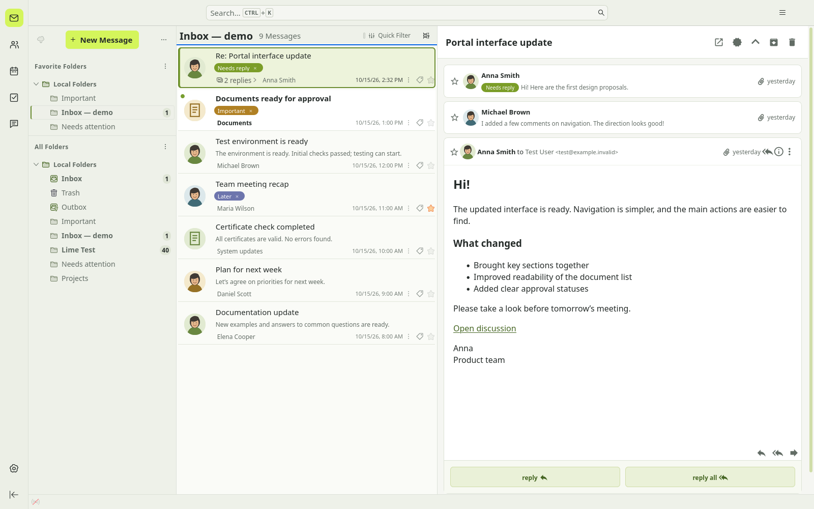
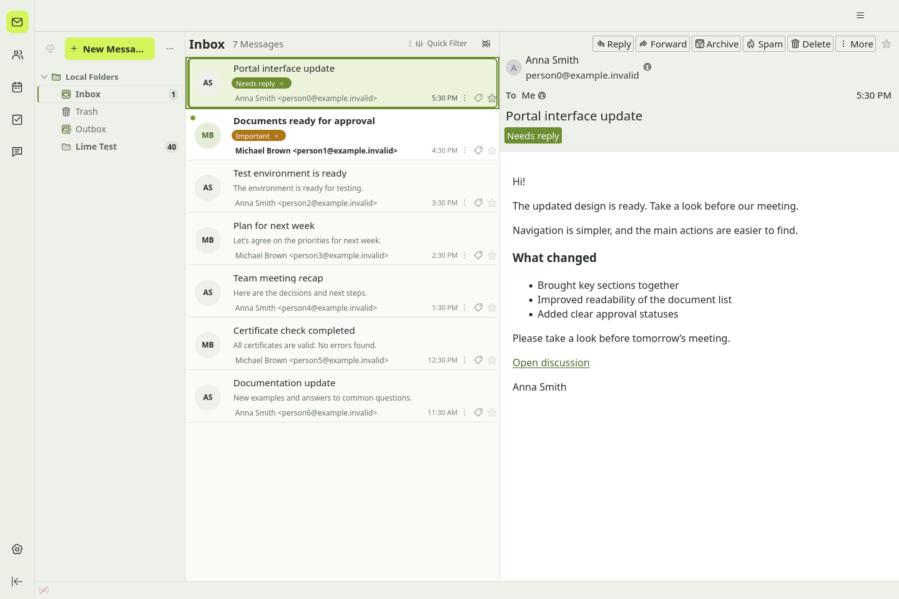
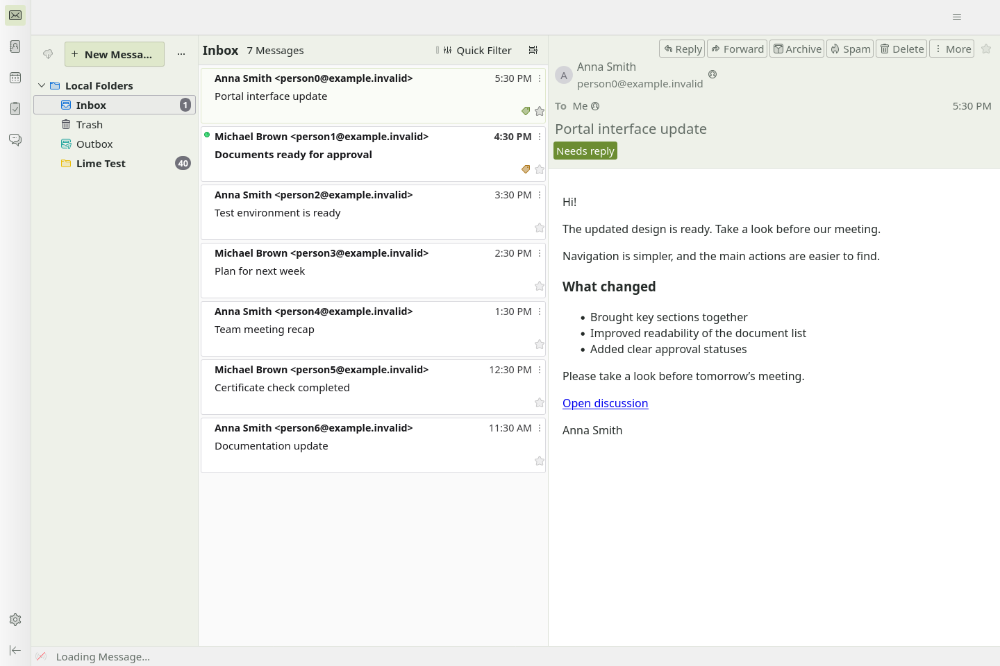

# Milk & Lime for Thunderbird

Light theme, sender avatars, tags & conversation styling.

### A calmer inbox. A clearer next step.

A light, lime-accented workspace for Thunderbird. Recognize the sender, see what matters, and keep your mail where it already lives.

**Thunderbird 157.x · Public beta candidate · MPL-2.0**  
[Русский](README.ru.md) · [Quick start](#quick-start) · [Avatars](#faces-for-people-icons-for-services) · [Privacy](lime-mail-cards/PRIVACY.md) · [Validation](docs/VALIDATION.md)



*Real Thunderbird, not a mockup. Milk & Lime + Lime Mail Cards + optional Conversations 4.3.16. Fictional mail and locally drawn demo contact images. No manually installed profile CSS.*

## Less searching. More context.

- **Know who wrote.** Contact photos, your own sender or domain images, and initials as a fallback.
- **See the next action.** Native tags become readable chips. Assign them from a message row; remove them with a click.
- **Catch up without opening everything.** Local previews and collapsed-thread summaries surface the latest message.
- **Keep the useful details.** Unread messages stand out. Dates, stars and thread counts stay within reach.
- **Make room your way.** Tags replace the preview by default; switch on a separate tag row if you want both.
- **One consistent look.** Soft panels, graphite text, lime accents and green links. Styling ships inside the extension.

## Theme and extension

Install **Milk & Lime** and **Lime Mail Cards** together: the theme sets the palette, while the extension adds interface styling, avatars, tags and thread summaries. No extra CSS files needed.

For a conversation reader with inline replies, add [Thunderbird Conversations](https://addons.thunderbird.net/en-US/thunderbird/addon/gmail-conversation-view/). It is optional: Cards works with Thunderbird's standard reader and also styles Conversations when installed.

<details>
<summary>See the ordinary reader and standalone theme</summary>

### Cards + theme, without Conversations



### Theme only



The theme alone changes colors, not the layout or message-list features.

</details>

## Quick start

**This is a local beta candidate, not a published release.** Build the packages below, or use a trusted XPI supplied by the maintainer. There is no store approval or public download link claimed here.

1. In Thunderbird, open **Add-ons and Themes → gear → Install Add-on From File**.
2. Install `milk-lime-theme-0.1.0.xpi` and `lime-mail-cards-0.3.0.xpi`.
3. Use the **vertical layout** and **three-line Cards View** for the reference layout.
4. Open Lime Mail Cards settings to configure tag placement and sender images.
5. Optionally install Conversations from its own listing and review its permissions.

No copying `userChrome.css`, no legacy CSS switch, no account migration. Disable Cards to remove its styling and row enhancements; existing mail and native tags remain.

## Faces for people. Icons for services.

Images are chosen in this order:

1. A photo from a **local Thunderbird contact**.
2. An image assigned to an **email address**, then to a **domain**, in Cards settings.
3. An **optional online domain logo**.
4. Initials when no image is available.

For example, assign a portrait to `anna@example.invalid` or a service icon to `notifications.example.invalid`. Images are stored locally. Automatic lookup is off on a fresh install; it finds domain logos, not people's photos.

The hero screenshot uses local address-book images. Conversations can display those contact photos independently. Cards' custom address/domain assignments are **not** synchronized into Conversations.

**Photos by nickname.** For notifications sent from a shared address, add that address in Cards settings → Contact nicknames. For a sender named `Anna (@anna)`, set a local contact's Nickname to `anna` and add a photo. Matching is exact and case-sensitive; duplicate nicknames are not used. This affects message-list avatars only, not reply addresses or sender verification.

## Your mail stays your mail

- No telemetry, cloud mailbox copy or AI processing is added by this project.
- Previews use locally available text; Cards does not force downloading or decrypting message bodies.
- Tags remain Thunderbird's native tags. Server synchronization still depends on your IMAP server.
- Online logos are opt-in. DuckDuckGo receives the sender's domain and your IP address, not the full email address or message content.
- The extension uses a **full-access Experiment API** to customize Thunderbird internals. Install only from a source you trust.

Read the [privacy policy](lime-mail-cards/PRIVACY.md).

## Compatibility and boundaries

Validated locally on **Ubuntu with Thunderbird 157.0.1**. The Conversations screenshots use **4.3.16**. Declared support is limited to Thunderbird 157.x.

Internal UI changes may require an update. Windows/macOS, screen readers, large production folders and encrypted-mail workflows still need validation. Some email-author colors are intentionally preserved; green links are not a promise to recolor every HTML message.

The complete extension currently targets direct XPI distribution. Its custom Experiment API is a store-submission constraint; see the [release checklist](docs/release-checklist.md). The ordinary theme is a separate package.

## Build and verify

Requires Node.js 22+, Python 3.9+ and `unzip`.

```sh
python3 scripts/build.py
XPI_FILE="$PWD/dist/lime-mail-cards-0.3.0.xpi" node --test lime-mail-cards/tests/*.test.cjs tests/*.test.cjs
(cd dist && sha256sum -c SHA256SUMS)
```

Builds are deterministic on the same toolchain. Output includes separate theme/extension XPIs, a source archive and checksums.

See [validation results](docs/VALIDATION.md) and [native test instructions](lime-mail-cards/README.md). Native tests require a disposable local-only profile, never a working mailbox.

## Feedback and contributions

Include your Thunderbird version, OS, Cards version, view mode and whether Conversations or manual CSS is enabled. Share a minimal reproduction and a screenshot with private information removed. Never attach a mail profile, credentials or real message contents.

Small, focused fixes and reproducible compatibility reports are welcome: [report an issue](https://github.com/rayout/thunderbird-milk-and-lime/issues).

## Credits and license

Created by **rayout (Alexandr Shapovalov)**. Licensed under [MPL-2.0](LICENSE).

Built for Thunderbird. Conversations is an independent third-party project by its own contributors. This project is not an official Thunderbird or Conversations product.
