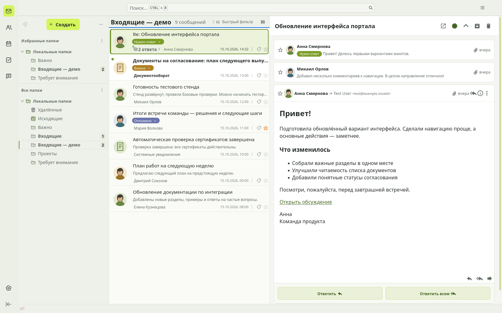
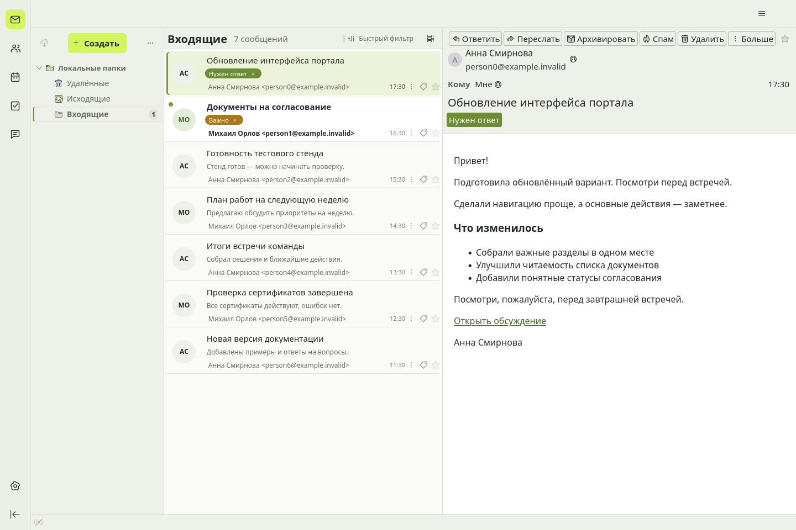
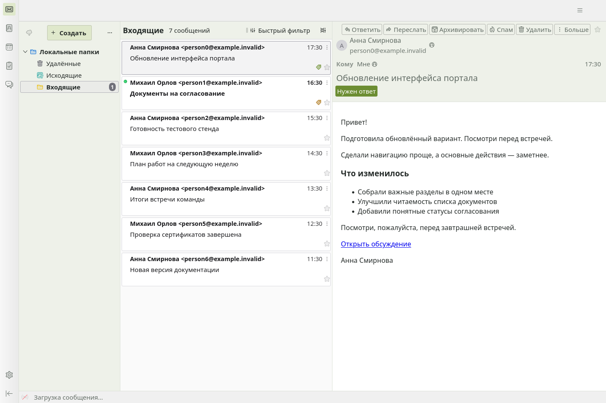

# Milk & Lime for Thunderbird

Светлая тема, аватары отправителей, метки и оформление переписки.

### Спокойнее интерфейс. Понятнее следующий шаг.

Светлое рабочее пространство для Thunderbird с лаймовыми акцентами. Узнавайте отправителей, замечайте важное и работайте с почтой там, где она уже хранится.

**Thunderbird 157.x · Кандидат в публичную бету · MPL-2.0**  
[English](README.md) · [Установка](#установка) · [Аватары](#людям--фотографии-сервисам--значки) · [Приватность](lime-mail-cards/PRIVACY.md) · [Проверки](docs/VALIDATION.md)



*Настоящий Thunderbird, не макет. Тема + Lime Mail Cards + необязательный Conversations 4.3.16. Письма вымышленные, демонстрационные аватары нарисованы локально и добавлены в контакты. Ручных CSS в профиле нет.*

## Меньше поиска. Больше контекста.

- **Сразу видно, кто написал.** Фото контактов, свои изображения для адресов и доменов, инициалы вместо пустого места.
- **Понятно, что делать дальше.** Штатные метки — заметными плашками. Назначайте их из строки письма и снимайте крестиком.
- **Не нужно открывать всё подряд.** Локальные превью и сводки цепочек показывают последнее сообщение.
- **Детали остаются под рукой.** Непрочитанные письма выделяются; рядом — дата, звезда и число ответов.
- **Плотность на ваш выбор.** Метки вместо превью или отдельная строка для тех, кому нужно и то и другое.
- **Цельное оформление.** Мягкие фоны, графитовый текст, лаймовые акценты и зелёные ссылки. Стили уже внутри расширения.

## Соберите свой вариант

| Компонент | Что даёт | Нужен обязательно? |
| --- | --- | --- |
| **Milk & Lime** | Самостоятельная цветовая тема без доступа к письмам | Нет; самый простой вариант |
| **Lime Mail Cards** | Встроенное оформление, карточки писем, метки, сводки цепочек и аватары | Для полного интерфейса |
| **[Thunderbird Conversations](https://addons.thunderbird.net/en-US/thunderbird/addon/gmail-conversation-view/)** | Просмотр переписки с ответом прямо внутри цепочки | Нет; устанавливается отдельно |

Lime Mail Cards работает и со штатным просмотром письма. Если установлен Conversations, встроенные стили применяются также к его области чтения. Исходники Conversations не меняем и сам плагин не распространяем.

<details>
<summary>Посмотреть вариант без Conversations и отдельную тему</summary>

### Тема + Cards, штатный просмотр письма



### Только тема



Обычная тема меняет цвета, но не расположение элементов и возможности списка писем.

</details>

## Установка

**Это локальный кандидат в бету, пока не опубликованный выпуск.** Соберите пакеты по инструкции ниже или используйте доверенный XPI от автора. Одобрение магазина и публичная ссылка на скачивание не заявляются.

1. Откройте **«Дополнения и темы» → шестерёнка → «Установить дополнение из файла»**.
2. Установите `milk-lime-theme-0.1.0.xpi` и `lime-mail-cards-0.3.0.xpi`.
3. Для вида как на снимке выберите **вертикальное расположение** и **трёхстрочные карточки**.
4. В настройках Lime Mail Cards задайте расположение меток и изображения отправителей.
5. При желании установите Conversations с его собственной страницы, проверив запрашиваемые разрешения.

Копировать `userChrome.css`, включать legacy-настройку и переносить аккаунты не нужно. Отключение Cards убирает его стили и доработки списка; письма и назначенные штатные метки остаются.

**Уже ставили наш личный CSS-комплект?** Сохраните резервную копию. Расширение не удаляет и не объединяет старые CSS профиля; повторяющиеся правила могут влиять на результат. Отдельный архив ручных стилей — альтернатива для установки без Cards, а не дополнительный шаг.

## Людям — фотографии, сервисам — значки

Изображения выбираются по порядку:

1. Фото из **локального контакта Thunderbird**.
2. Картинка, назначенная **адресу**, затем **домену** в настройках Cards.
3. **Необязательный поиск логотипа домена** в сети.
4. Инициалы, если картинки нет.

Например, можно назначить портрет адресу `anna@example.invalid`, а значок сервиса — домену `notifications.example.invalid`. Картинки хранятся локально. На новой установке автоматический поиск выключен; он ищет логотипы доменов, а не фотографии людей.

На главном скриншоте используются изображения из адресной книги. Conversations может показывать эти фото самостоятельно. Наши назначения картинок адресам и доменам **не передаются** в Conversations.

Общий адрес уведомлений считается одним отправителем. Публичная сборка не определяет людей из GitLab по имени отправителя и не содержит привязок к конкретной компании.

## Ваша почта остаётся вашей

- Проект не добавляет телеметрию, облачную копию почты или обработку писем нейросетью.
- Превью используют доступный локально текст. Cards не запускает принудительную загрузку или расшифровку писем.
- Метки остаются штатными метками Thunderbird. Синхронизация зависит от IMAP-сервера.
- Поиск логотипов включается отдельно. DuckDuckGo получает домен отправителя и ваш IP, но не полный адрес или содержимое письма.
- Для изменения внутреннего интерфейса расширению нужен **полный доступ через Experiment API**. Устанавливайте его только из доверенного источника.

Подробнее: [приватность](lime-mail-cards/PRIVACY.md) и [совместимость меток с Zimbra](docs/zimbra.md).

## Совместимость и ограничения

Локально проверено на **Ubuntu и Thunderbird 157.0.1**. На снимках с перепиской — **Conversations 4.3.16**. Заявленный диапазон ограничен Thunderbird 157.x.

Обновления внутреннего интерфейса могут потребовать новой версии расширения. Windows/macOS, экранные дикторы, большие рабочие папки и сценарии с зашифрованной почтой ещё требуют проверки. Часть авторских цветов писем намеренно сохраняется: зелёные ссылки не означают принудительную перекраску любого HTML-письма.

Полное расширение пока рассчитано на установку из XPI. Собственный Experiment API ограничивает подачу в магазин — подробности в [списке готовности выпуска](docs/release-checklist.md). Обычная тема поставляется отдельно.

## Сборка и проверки

Нужны Node.js 22+, Python 3.9+ и `unzip`.

```sh
python3 scripts/build.py
XPI_FILE="$PWD/dist/lime-mail-cards-0.3.0.xpi" node --test lime-mail-cards/tests/*.test.cjs tests/*.test.cjs
(cd dist && sha256sum -c SHA256SUMS)
```

На одинаковом наборе инструментов сборка воспроизводима. В результате получаются XPI темы и расширения, исходники, альтернативный архив ручных стилей и контрольные суммы.

[Результаты проверок](docs/VALIDATION.md) · [Инструкции для тестов в Thunderbird](lime-mail-cards/README.md). Для них нужен отдельный профиль с вымышленной локальной почтой, не рабочий ящик.

## Обратная связь и участие

Укажите версии Thunderbird и Cards, ОС, режим списка, наличие Conversations и ручных CSS. Приложите короткие шаги воспроизведения и снимок без личных данных. Не прикладывайте почтовый профиль, пароли или содержимое настоящих писем.

Приветствуются небольшие самостоятельные исправления и воспроизводимые отчёты о совместимости: [сообщить о проблеме](https://github.com/rayout/thunderbird-milk-and-lime/issues).

## Авторство и лицензия

**rayout (Alexandr Shapovalov)** · [MPL-2.0](LICENSE).

Создано для Thunderbird. Conversations — независимый сторонний проект своих авторов. Milk & Lime и Lime Mail Cards не являются официальными продуктами Thunderbird или Conversations.
